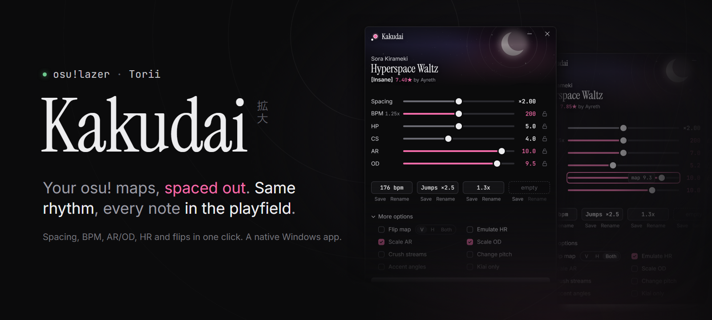
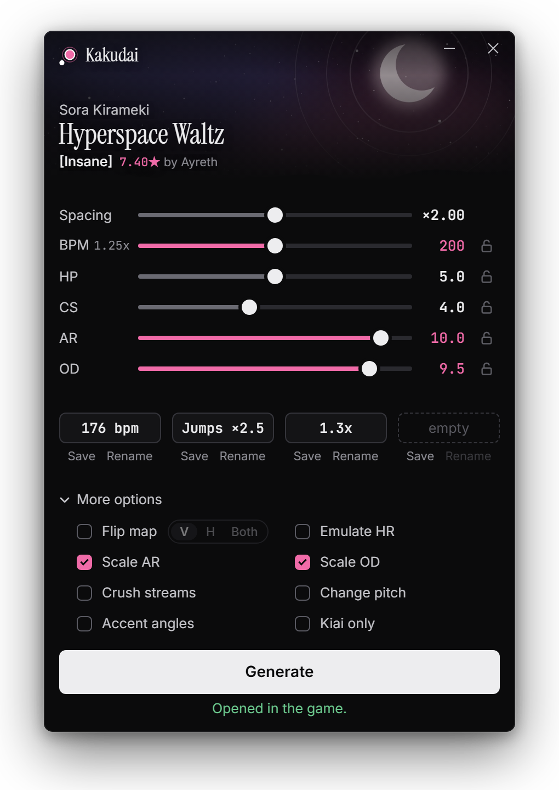

#  Kakudai



**Kakudai (拡大, "enlarge") spaces out the osu! map you have selected**, in a small native Windows window next to
osu!lazer or Torii. Pick a map in song select, set how far the jumps should go, change the BPM, AR, OD or HP if you
want, and press **Generate**: a new difficulty opens in the game as a separate map, with the same rhythm, the same
patterns, and every note still inside the playfield. Nothing to configure, nothing sent about you.

<p align="center">
  
  &nbsp;
  
</p>

## Download

Grab `Kakudai-win-x64.zip` from the [latest release](../../releases/latest), unzip it anywhere and run
`Kakudai.exe`. The .NET runtime is included. Windows 10/11, x64, with the Microsoft Edge WebView2 runtime (already
there on Windows 11, and on most Windows 10 machines through Edge).

## Works with

| Client | How the selected map is found |
|---|---|
| **osu!lazer** and **Torii** | the `Game-wide working beatmap updated to …` line the game writes to its log in `%AppData%\osu\logs`, looked up in a **copy** of `client.realm` (never the original). That gives the `.osu`, the audio, the background and the hitsounds from `files/`. |
| **osu!stable** | not supported. |

- Kakudai reads the default data folder, `%AppData%\osu`, which lazer and Torii share unless you moved it.
- Mods are not written to lazer's log, so they are not followed: set the rate and the stats in Kakudai instead.
- osu!standard only. On a taiko, catch or mania difficulty the window says so and waits.

## Using it

Start Kakudai and pick a map in song select: the window shows it, with the **star rating of the difficulty your
settings would make** next to its name (in pink when it differs from the map's; hover it to see the map's own).
It follows every change of setting. Then:

- **Spacing** ×1 to ×3: how much the jumps are spread out. ×1 leaves the positions alone.
- **BPM**: the slider sets the rate (0.5x to 2x), the value on the right is the resulting BPM and can be typed in.
  The audio is re-timed to an mp3, at the same pitch unless **Change pitch** is ticked (nightcore style).
- **HP, CS, AR, OD**: start at the map's values. Drag a slider to set your own. **Double-click** a slider to go back
  to the map's value.
- **Locks** (next to BPM and each stat): keep that value when you switch maps. A locked BPM keeps the target BPM
  and recomputes the rate for the next map.
- **Profiles**: four slots. **Save** stores every setting, a click on the slot loads it back, **Rename** gives it a
  name (by default it shows its BPM or rate).
- **More options**:
  - **Scale AR / Scale OD** (on by default): when the rate changes, AR and OD follow so the approach and the hit
    windows feel like with DT or HT, as osu!trainer does. Moving or locking the slider turns them off.
  - **Emulate HR**: the Hard Rock stats (CS ×1.3, HP/AR/OD ×1.4, capped at 10) applied over your values.
  - **Flip map**: mirror the playfield vertically (like HR), horizontally, or both.
  - **Crush streams**: streams keep their original spacing, only the jumps grow.
  - **Accent angles**: the turns between jumps get sharper, streams are left alone.
  - **Kiai only**: only the notes inside kiai sections move; the rest of the map stays where it was.
- **Generate**: writes the new difficulty and opens it with the program Windows uses for `.osz` files, so lazer or
  Torii imports it right away.

When a new version is published on GitHub, a small banner at the top of the window offers to download it (the only
network call: an anonymous check of the latest release, see below).

The difficulty name says what was done, for example `[2x spaced 1.25x (200bpm) HR AR9.5 Insane]`. Each generated
difficulty is its own beatmap set, tagged `kakudai`: type `kakudai` in song select to find them all. Selecting one
of them in the game works too: it can be spaced out again.

Settings and profiles are kept in `%LocalAppData%\Kakudai\settings.json`.

## How the spacing works

- The map is cut into **patterns** (a jump, a triangle, a slider pair, a stream…). Each one is enlarged and moved as
  a **rigid piece**: turned and shifted as a whole, never bent, so its shape and flow stay recognisable.
- The jump between two patterns grows with **Spacing**, but **big jumps are capped**: at ×2 a 40 px move becomes
  about 80 px, while a 300 px jump grows to about 440 px instead of flying from one corner to the other.
- **Streams stay continuous.** A long stream may be placed in several pieces, but the pieces are joined at stream
  spacing, in the same direction: a stream is never cut into jumps. If it cannot fit, the whole stream is scaled
  down a little rather than broken.
- **Everything stays in the playfield**: every circle, and every point of every slider. When a pattern does not fit,
  Kakudai turns the next one, shortens the jump a little or shrinks the pattern a little, whichever changes the map
  least.
- The rhythm, hitsounds and combo colours are kept as they are. With a rate, every time in the map (notes, timing
  points, breaks, preview) is divided by the rate and the song is re-timed to match, so the notes
  land on the same spot in the music.

## Privacy and safety

- **Read only.** Kakudai reads the game's log and a **copy** of `client.realm` made in the temp folder; the game's
  own database is never opened.
- **Nothing is written in the game's folder.** The new map is a `.osz` saved in the `generated` folder next to
  `Kakudai.exe`; the game imports it like any downloaded map, as a separate set tagged `kakudai`. Your original
  map is never modified.
- **One network call, anonymous.** At start, Kakudai asks GitHub for its latest release
  (`api.github.com/repos/Ayreth/Kakudai/releases/latest`), with no cookie, no account and nothing about you or your
  maps: only a User-Agent naming Kakudai and its version. If GitHub does not answer within 5 seconds, or you are
  offline, nothing happens. **Download** opens the release page in your browser; Kakudai never downloads or installs
  anything itself. No other request, no telemetry. The page of the window is local (WebView2, fonts included).
- To remove everything Kakudai made: delete its folder, `%LocalAppData%\Kakudai` and `%Temp%\Kakudai`, and the
  `kakudai` sets in the game if you no longer want them.

## Build from source

```
dotnet publish src/Kakudai.App -c Release -r win-x64 --self-contained true -o out
```

.NET 10 SDK. WinForms + WebView2 for the window (the page is in `src/Kakudai.App/wwwroot`), the map work is in
`src/Kakudai.Core`, tests in `tests/Kakudai.Tests` (`dotnet test`). The logo and the icon are made by
`docs/logo/make-icon.ps1`, the banner by `docs/banner/render.ps1`, both with headless Edge.

## Credits

- Fonts: [Instrument Serif](https://github.com/Instrument/instrument-serif),
  [Inter](https://github.com/rsms/inter) and [JetBrains Mono](https://github.com/JetBrains/JetBrainsMono), under the
  SIL Open Font License (see `src/Kakudai.App/wwwroot/fonts/`).
- [osu!](https://github.com/ppy/osu) libraries by ppy (`ppy.osu.Game.Rulesets.Osu`, MIT) to read maps and the
  game's database.
- [BASS and BASS_FX](https://www.un4seen.com/) by un4seen, shipped with osu!framework, to decode and re-time the
  audio (free for non-commercial use).
- [LAME](https://lame.sourceforge.io/) (LGPL) through [NAudio.Lame](https://github.com/Corey-M/NAudio.Lame), to encode
  the mp3.
- Microsoft Edge WebView2 for the window.
- The trainer controls are modelled on osu!trainer.

Written with an AI assistant (Claude, by Anthropic); read the code before trusting it. A fan project, not affiliated
with or endorsed by ppy Pty Ltd, nor with Torii.

## License

MIT, see [LICENSE](LICENSE). Fonts are under their own OFL licences.
