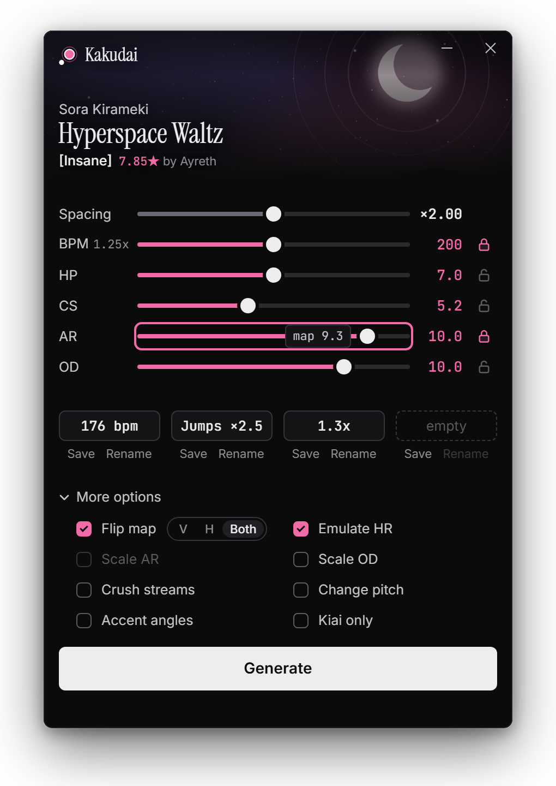

#  Kakudai


**Kakudai (拡大, "enlarge") spaces out the osu! map you have selected**, in a small window next to osu!stable,
osu!lazer or Torii, on Windows, Linux and macOS. Pick a map in song select, set how far the jumps should go, change the BPM, AR, OD or HP if you
want, and press **Generate**: a new difficulty opens in the game as a separate map, with the same rhythm, the same
patterns, and every note still inside the playfield. Nothing to configure, nothing sent about you.

<p align="center">
  
  &nbsp;
  
</p>

## Download

From the [latest release](../../releases/latest). The .NET runtime and everything else Kakudai needs are included.

| System | File | Then |
|---|---|---|
| **Windows** 10/11, x64 | `Kakudai-win-x64.zip` | Unzip it anywhere and run `Kakudai.exe`. Needs the Microsoft Edge WebView2 runtime (already there on Windows 11, and on most Windows 10 machines through Edge). |
| **Linux**, x64 | `Kakudai-linux-x64.tar.gz` | `tar xzf Kakudai-linux-x64.tar.gz` and run `Kakudai/Kakudai`; `Kakudai/install.sh` adds it to the application menu. Needs WebKitGTK 4.1 and GTK 3 (`libwebkit2gtk-4.1-0` on Debian/Ubuntu, `webkit2gtk4.1` on Fedora, `webkit2gtk-4.1` on Arch), present on most desktops. |
| **macOS** 11+, Apple Silicon | `Kakudai-macos-arm64.zip` | Unzip and move `Kakudai.app` to Applications. It is not notarised: the first time, right-click it → **Open** (or run `xattr -dr com.apple.quarantine /Applications/Kakudai.app`). |
| **macOS** 11+, Intel | `Kakudai-macos-x64.zip` | The same. |

## Works with

| Client | How the selected map is found | Windows | Linux | macOS |
|---|---|---|---|---|
| **osu!lazer** and **Torii** | the `Game-wide working beatmap updated to …` line the game writes to its log, looked up in a **copy** of `client.realm` (never the original). That gives the `.osu`, the audio, the background and the hitsounds from `files/`. | yes | yes | yes |
| **osu!stable** | read from the game's memory, read only, the way osu-trainer and tosu do (same patterns as tosu), then the `.osu`, the audio and the background from your Songs folder. On Linux, osu!stable runs under Wine: see below. If [tosu](https://github.com/tosuapp/tosu) runs and Kakudai cannot read the memory itself, Kakudai asks tosu instead. | yes | yes | no |

- Lazer's data folder is `%AppData%\osu` on Windows, `~/.local/share/osu` on Linux, `~/Library/Application Support/osu`
  on macOS. Moved it from the game's settings? The game leaves a `storage.ini` there pointing to the new folder, and
  Kakudai follows it, as the game does (several moves too); a portable install (data next to the game) and Torii's
  own folder are found as well. Kakudai follows the log the game is writing, so it reads the data of the game being
  played, whichever it is.
- osu!stable's Songs folder is the `BeatmapDirectory` of your `osu!.<name>.cfg`, else `Songs` next to `osu!.exe`.
- Mods are not written to lazer's log, so they are not followed: set the rate and the stats in Kakudai instead.
  (osu!stable's mods are not followed either.)
- osu!standard only. On a taiko, catch or mania difficulty the window says so and waits.
- **macOS and osu!stable**: osu!stable only runs there through Wine, and macOS lets no app read another one's memory
  without root. Use lazer.

### osu!stable on Linux

Kakudai finds the Wine process named `osu!.exe` and reads it with `process_vm_readv`. Most distributions (Ubuntu,
Fedora, …) only let a program read the memory of the programs it started itself (Yama `ptrace_scope` = 1); the window
then says *can't read osu!stable's memory*. Either:

- give Kakudai the right to read it, once (again after each update):
  `sudo setcap cap_sys_ptrace=eip /path/to/Kakudai/Kakudai`
- or run [tosu](https://github.com/tosuapp/tosu): Kakudai asks it for the map (on `127.0.0.1` only) when it cannot
  read the memory itself.

The new map is handed to the game the same way as on Windows: Kakudai starts `osu!.exe` again with the `.osz`, through
the same `wine` and in the same prefix as the running game (`WINEPREFIX` and the rest of the game's environment).

## Using it

Start Kakudai and pick a map in song select: the window shows it, with the **star rating of the difficulty your
settings would make** next to its name (in pink when it differs from the map's; hover it to see the map's own).
It follows every change of setting. Then:

- **Spacing** ×1 to ×3: how much the jumps are spread out. ×1 leaves the positions alone.
- **BPM**: the slider sets the rate (0.5x to 2x), the value on the right is the resulting BPM and can be typed in.
  The audio is re-timed to an mp3, at the same pitch unless **Change pitch** is ticked (nightcore style).
- **HP, CS, AR, OD**: start at the map's values. Drag a slider to set your own. **Double-click** a slider to go back
  to the map's value.
- **Locks** (next to BPM and each stat): keep that value when you switch maps. A locked BPM keeps the target BPM
  and recomputes the rate for the next map.
- **Profiles**: four slots. **Save** stores every setting, a click on the slot loads it back, **Rename** gives it a
  name (by default it shows its BPM or rate).
- **More options**:
  - **Scale AR / Scale OD** (on by default): when the rate changes, AR and OD follow so the approach and the hit
    windows feel like with DT or HT, as osu!trainer does. Moving or locking the slider turns them off.
  - **Emulate HR**: the Hard Rock stats (CS ×1.3, HP/AR/OD ×1.4, capped at 10) applied over your values.
  - **Flip map**: mirror the playfield vertically (like HR), horizontally, or both.
  - **Crush streams**: streams keep their original spacing, only the jumps grow.
  - **Accent angles**: the turns between jumps get sharper (as far as a jump may lean), streams are left alone,
    and no note lands on a recent one.
  - **Kiai only**: only the notes inside kiai sections move; the rest of the map stays where it was.
- **Generate**: writes the new difficulty as a `.osz` and hands it to the game the map came from, which imports it
  right away: osu!stable is started again with the file (as a double-click on a `.osz` does, like osu-trainer); lazer
  and Torii get it from the program Windows uses for `.osz` files or, on Linux and macOS, through the running game's
  own IPC pipe (what a second `osu!` started with the file would send). If the game does not take it, the window says
  where the `.osz` is: drag it onto osu!.

When a new version is published on GitHub, a small banner at the top of the window offers to download it (the only
network call: an anonymous check of the latest release, see below).

The difficulty name says what was done, for example `[2x spaced 1.25x (200bpm) HR AR9.5 Insane]`. Each generated
difficulty is its own beatmap set, tagged `kakudai`: type `kakudai` in song select to find them all. Selecting one
of them in the game works too: it can be spaced out again.

Settings and profiles are kept in `settings.json`, in `%LocalAppData%\Kakudai` on Windows,
`~/.local/share/Kakudai` on Linux (`$XDG_DATA_HOME`), `~/Library/Application Support/Kakudai` on macOS.

## How the spacing works

- **The structure of the map is kept.** Every move keeps the direction it has in the map (a jump may lean by 25° at
  most, to make room) and is only made longer: a vertical jump stays vertical, a pattern keeps its orientation,
  nothing is turned to fit, no jump ends up shorter than in the map, and sliders are never turned.
- Every move grows with **Spacing**, but **big jumps are capped**: at ×2 a 40 px move becomes about 80 px, while a
  300 px jump grows to about 440 px instead of flying from one corner to the other.
- **Streams are spaced as one piece**: the same zoom all along a stream, and they may curve smoothly away from an
  edge, never bend at a note. Past ×2.5, streams stop growing (they would only fit by curling).
- **A stream stuck against an edge is turned as one piece.** When a map already fills the playfield, a stream that
  runs along an edge has no room to grow in its own direction. Kakudai then turns that stream (and only it) toward the
  middle, by the smallest angle that lets it be spaced (60° at most), and the jump right after it re-aims as little as
  it can (it may lose up to 20 % of its length). A turn is kept only if it does not take the room of a stream next to
  it. The streams that have room, and every other pattern, are never turned.
- **More spacing never gives a smaller map.** The positions are the solution of one convex problem, so ×2.6 is
  always a little more spread than ×2.5, and the star rating follows.
- **Everything stays in the playfield**: every circle, and every point of every slider. When the map does not fit,
  the moves that would leave the playfield grow less, the rest as much as they can.
- The rhythm, hitsounds and combo colours are kept as they are. With a rate, every time in the map (notes, timing
  points, breaks, preview) is divided by the rate and the song is re-timed to match, so the notes
  land on the same spot in the music.

## Privacy and safety

- **Read only.** Kakudai reads lazer's log and a **copy** of `client.realm` made in the temp folder; the game's
  own database is never opened. osu!stable's memory is only read (no injection, nothing written), like tosu and
  osu-trainer do, and its map files are read where they are.
- **Nothing is written in the game's folder.** The new map is a `.osz` saved in the `generated` folder (next to
  `Kakudai.exe` on Windows, in Kakudai's settings folder on Linux and macOS); the game imports it itself like any
  downloaded map, as a separate set tagged `kakudai`. Your original map is never modified.
- **tosu**, only for osu!stable when its memory cannot be read: `http://127.0.0.1:24050/json/v2`, on your machine.
- **One network call, anonymous.** At start, Kakudai asks GitHub for its latest release
  (`api.github.com/repos/Ayreth/Kakudai/releases/latest`), with no cookie, no account and nothing about you or your
  maps: only a User-Agent naming Kakudai and its version. If GitHub does not answer within 5 seconds, or you are
  offline, nothing happens. **Download** opens the release page in your browser; Kakudai never downloads or installs
  anything itself. No other request, no telemetry. The page of the window is local (WebView2 on Windows, WebKit on
  Linux and macOS, fonts included).
- To remove everything Kakudai made: delete its folder, its settings folder (above) and `Kakudai` in the temp folder,
  and the `kakudai` sets in the game if you no longer want them.

## Build from source

```
dotnet publish src/Kakudai.App -c Release -r win-x64 --self-contained true -o out          # Windows
dotnet publish src/Kakudai.Desktop -c Release -r linux-x64 --self-contained true -o out    # Linux (or osx-arm64, osx-x64)
```

.NET 10 SDK. The map work is in `src/Kakudai.Core`; the page of the window in `src/Kakudai.App/wwwroot`, and what
connects it to the Core and to the games in `src/Kakudai.Host`. Two windows show that page: `src/Kakudai.App`
(WinForms + WebView2, Windows) and `src/Kakudai.Desktop` ([Photino](https://www.tryphotino.io/): WebKitGTK on
Linux, WKWebView on macOS; it also runs on Windows, for testing). `KAKUDAI_TRACE=<file>` makes the latter log its
messages, requests and sizes. Tests in `tests/Kakudai.Tests` (`dotnet test`; the audio tests need libmp3lame on Linux
and macOS). `.github/workflows/release.yml` tests on the three systems and builds the release files, LAME included
(`packaging/` makes the macOS `.app` and the Linux menu entry). The logo and the icon are made by
`docs/logo/make-icon.ps1`, the banner by `docs/banner/render.ps1`, both with headless Edge.

## Credits

- Fonts: [Instrument Serif](https://github.com/Instrument/instrument-serif),
  [Inter](https://github.com/rsms/inter) and [JetBrains Mono](https://github.com/JetBrains/JetBrainsMono), under the
  SIL Open Font License (see `src/Kakudai.App/wwwroot/fonts/`).
- [osu!](https://github.com/ppy/osu) libraries by ppy (`ppy.osu.Game.Rulesets.Osu`, MIT) to read maps and the
  game's database.
- [BASS and BASS_FX](https://www.un4seen.com/) by un4seen, shipped with osu!framework, to decode and re-time the
  audio (free for non-commercial use).
- [LAME](https://lame.sourceforge.io/) (LGPL), to encode the mp3: the Windows build of
  [NAudio.Lame](https://github.com/Corey-M/NAudio.Lame), built from LAME 3.100's sources for Linux and macOS.
- Microsoft Edge WebView2 for the Windows window, [Photino](https://github.com/tryphotino/photino.NET) (Apache 2.0)
  for the Linux and macOS one.
- The trainer controls are modelled on osu!trainer, and osu!stable is handled the way it does: memory read for the
  selected map, `.osz` handed to the game. Memory patterns for osu!stable from [tosu](https://github.com/tosuapp/tosu).

Written with an AI assistant (Claude, by Anthropic); read the code before trusting it. A fan project, not affiliated
with or endorsed by ppy Pty Ltd, nor with Torii.

## License

MIT, see [LICENSE](LICENSE). Fonts are under their own OFL licences.
